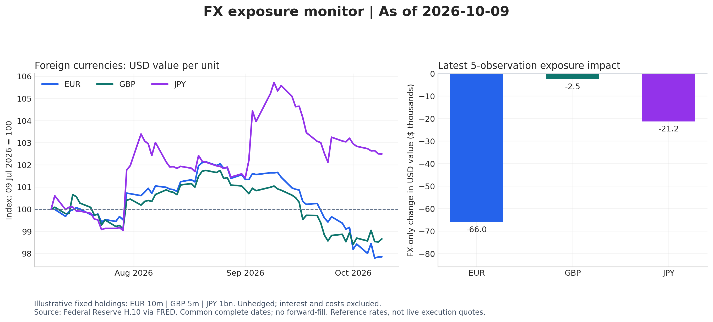

# FX Exposure Monitor — Python + SQL

> A small, auditable FX monitoring pipeline: FRED exchange-rate data normalized in Python, stored in SQLite, analysed with SQL, and summarized in a client insight memo — with data-quality reporting built in, not bolted on.



## What it does

- Ingests a FRED FX snapshot (`data/fred_fx_snapshot.csv` + source metadata)
- Normalizes rates into a SQLite database (`outputs/fx_monitor.sqlite`) using `sql/schema.sql`
- SQL analysis (`sql/analysis.sql`, `sql/client_monitor.sql`): exposure summaries, client monitor table, portfolio summary
- Quality controls: excluded-dates log, quality report (JSON) — bad or missing observations are quarantined visibly
- Walkthrough notebook (`task2_walkthrough.ipynb`) shows every step end to end
- Output memo (`outputs/client_insight_memo.md`) translates the numbers into client language

## Run it

```bash
pip install -r requirements.txt
python task2.py
```

Full write-up: `reports/Task2_FX_SQL_Report.pdf`.

## Structure

```
task2.py                 pipeline: ingest → normalize → SQL → outputs
task2_walkthrough.ipynb  step-by-step notebook version
sql/                     schema, analysis and client-monitor queries
data/                    FRED FX snapshot + source metadata (public data)
outputs/                 SQLite db, normalized FX, monitor tables, chart, memo
reports/                 completed-run report (PDF)
```

## Data source

FRED, Federal Reserve Bank of St. Louis (public).

## Author

**Umer Farooq** — Economic & Climate Risk Analyst · [LinkedIn](https://www.linkedin.com/in/umer-farooq-gojra/) · [GitHub](https://github.com/umerfarooq7424)

## License

MIT — see LICENSE.
